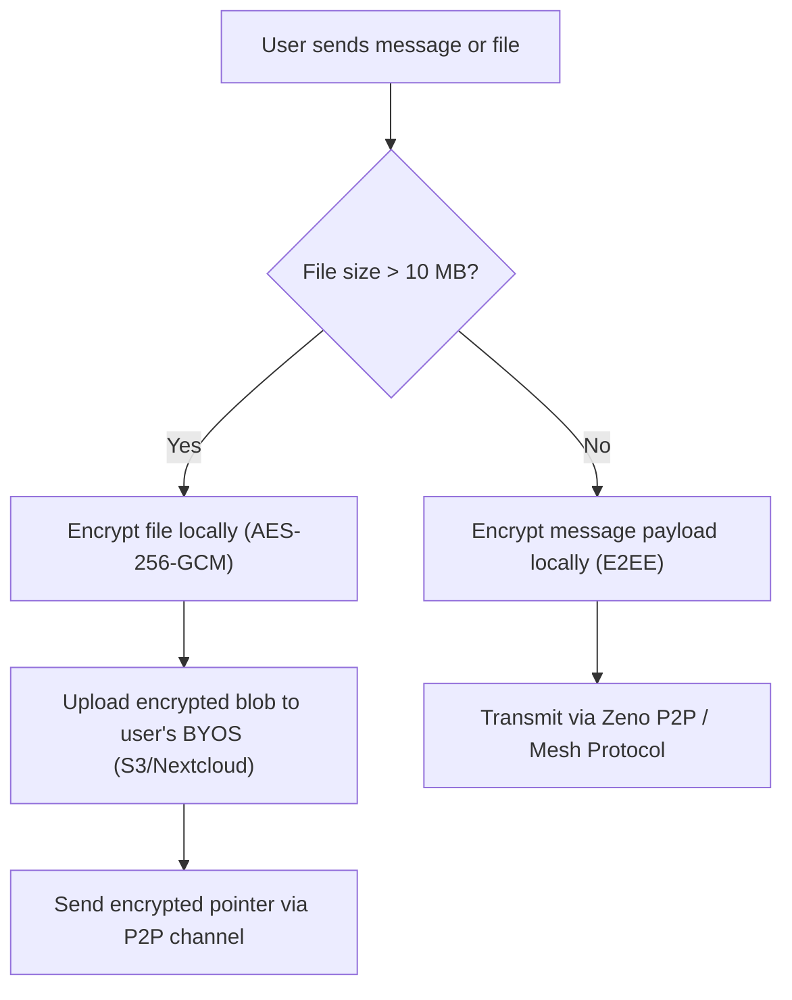

# Zeno — Secure Developer Collaboration Hub

<p align="center">
  <strong>Decentralized, zero-knowledge communication platform & developer workspace.</strong><br>
  Built with Rust (Tauri v2) & React 19 • Extremely lightweight (~64 MB RAM) • End-to-End Encrypted
</p>

<p align="center">
  <a href="LICENSE"></a>
  <a href="https://tauri.app/"></a>
  <a href="https://microsoft.github.io/monaco-editor/"></a>
  <a href="https://github.com/Goddev-Archer/Zeno/releases"></a>
  <a href="SECURITY.md"></a>
</p>

<p align="center">
  🌍 <strong>Languages:</strong>
  <a href="README.en.md">🇬🇧 <strong>English</strong></a> • 
  <a href="README.md">🇩🇪 Deutsch</a>
</p>

---

## 🌟 Overview

**Zeno** is a decentralized communication and developer collaboration hub engineered for developers, technical teams, and privacy-conscious professionals. Zeno combines real-time encrypted messaging and voice channels with a deeply integrated, client-side Monaco code editor, native Git source control, and an uncompromising zero-knowledge architecture.

Unlike resource-heavy Electron-based alternatives, Zeno is natively compiled with Rust and Tauri v2, providing instant startup times and an ultra-lean memory footprint of only **~64 MB RAM**.

---

## 🛡️ Digital Sovereignty & Zero-Knowledge Architecture

Privacy and digital telecommunications confidentiality are non-negotiable core principles. Zeno safeguards these principles through robust cryptographic foundations:

* **Zero Central Message Storage:** Your conversations belong to you. Through a serverless P2P mesh and BYOS (*Bring Your Own Storage*), you choose where your data resides (e.g., your own Nextcloud or S3 bucket).
* **Local Key Ownership:** Encryption keys are derived client-side via **Argon2id** and never leave your local device.
* **Isolated Client-Side Execution:** Code shared or inspected within the In-Chat IDE is executed locally in an isolated sandbox. No remote server reads your code or receives output telemetry.
* **Zero Telemetry Guarantee:** Zeno collects zero telemetry, zero analytics, and zero device fingerprints.

---

## ⚡ Key Features at a Glance

* 📝 **In-Chat Monaco IDE:** Full-featured VS Code-style editor built directly into the client, including syntax highlighting, multi-file project tree, and interactive code execution.
* 🌿 **Native Git Source Control:** Inspect modified files, review line-by-line diffs, stage/unstage changes, switch branches, and commit directly from within Zeno.
* 📦 **BYOS (Bring Your Own Storage):** Complete separation between messaging and heavy file storage. Seamlessly integrate Nextcloud, MinIO, or AWS S3 for large file sharing.
* ⚡ **Ultra-Lightweight & Performant:** Native Rust backend (Tauri v2) + React 19 frontend consuming ~64 MB RAM compared to 500+ MB in traditional Electron apps.
* 🚀 **Portable Standalone Binaries:** Portable Windows releases (`zeno.exe`) ship with self-contained runtimes — no manual Node.js or Rust installation required for end users.
* 🔑 **Cryptographically Signed Releases:** Every release binary and zip archive is signed with our official GPG key (`A3ACEB626EBFB7EC`).

---

## 📊 Architecture & Cryptographic Flow



---

## 🚀 Getting Started

### Option A: Portable Binary (No Installation Required)

Download the latest portable standalone archive from the [Releases page](https://github.com/Goddev-Archer/Zeno/releases):

1. Download `zeno-v0.2.0-alpha-windows-x64-portable.zip`.
2. Extract the archive and run `zeno.exe`.
3. The bundled `bin/node.exe` is automatically recognized by the internal IDE.

### Option B: Building from Source

#### Prerequisites
* **Node.js** (v18+) and **npm**
* **Rust toolchain** (stable, install via [rustup.rs](https://rustup.rs))
* **C++ Build Tools** (e.g. Visual Studio Build Tools on Windows)

#### Step-by-Step Build
```bash
# 1. Clone the repository
git clone https://github.com/Goddev-Archer/Zeno.git
cd Zeno

# 2. Install frontend dependencies
npm install

# 3. Start Tauri in development mode (with hot-reload)
npm run tauri dev

# 4. Build optimized production release
npm run tauri build
```

---

## 🔒 Cryptographic Verification (GPG)

All official releases are signed with the following GPG key:

* **Key ID:** `A3ACEB626EBFB7EC`
* **Key Name:** `Goddev Archer (Zeno Release Signing Key)`
* **Public Key:** Included in release archives as `zeno-release-public-key.asc`.

To verify the integrity and authenticity of a release:

```bash
# 1. Import the public signing key
gpg --import zeno-release-public-key.asc

# 2. Verify release executable signature
gpg --verify zeno.exe.asc zeno.exe

# 3. Or verify checksums
sha256sum -c SHA256SUMS
gpg --verify SHA256SUMS.asc SHA256SUMS
```

---

## 🛡️ Security & Responsible Disclosure

We take security seriously. If you discover a vulnerability or cryptographic defect, please report it privately via email:

* **Security Contact:** [goddevarcher@outlook.com](mailto:goddevarcher@outlook.com)
* **GPG Key:** `A3ACEB626EBFB7EC`
* **Policy & Details:** Please review our complete [SECURITY.md](SECURITY.md) before submitting.

---

## 📜 License

Zeno is released under the **Apache License 2.0**.  
See [LICENSE](LICENSE) for details. Third-party library licenses are documented in [LICENSES.md](LICENSES.md).
