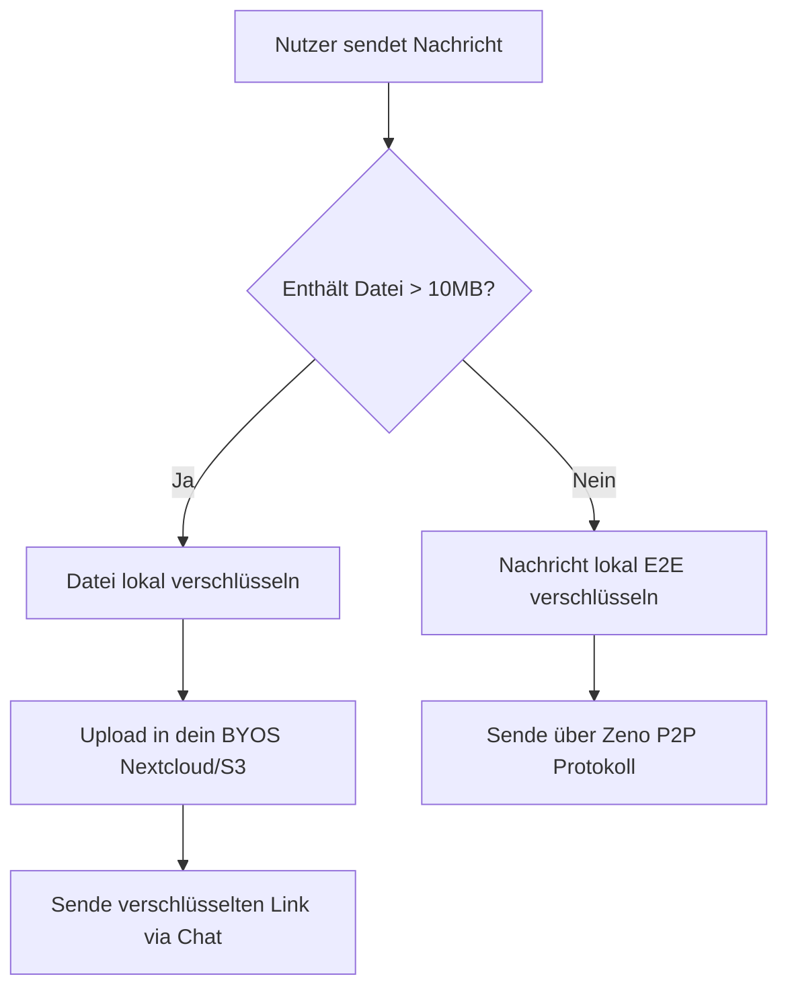

# Zeno — Secure Developer Collaboration Hub

<p align="center">
  <strong>Dezentrale, serverlose Kommunikationsplattform &amp; Entwickler-Workspace.</strong><br>
  Entwickelt mit Rust (Tauri v2) &amp; React 19 • Extrem leichtgewichtig (~64 MB RAM) • Ende-zu-Ende verschlüsselt
</p>

<p align="center">
  <a href="LICENSE"></a>
  <a href="https://tauri.app/"></a>
  <a href="https://microsoft.github.io/monaco-editor/"></a>
  <a href="https://github.com/Goddev-Archer/Zeno/releases"></a>
  <a href="SECURITY.md"></a>
</p>

<p align="center">
  🌍 <strong>Sprachen / Languages:</strong>
  <a href="README.md">🇩🇪 <strong>Deutsch</strong></a> • 
  <a href="README.en.md">🇬🇧 English</a>
</p>

---

## 🛡️ Digitale Souveränität & Zero-Knowledge-Architektur (Art. 10 GG)

Die Privatsphäre und das verfassungsmäßige Fernmeldegeheimnis (**Art. 10 GG** sowie **Art. 8 EMRK**) sind Grundpfeiler freier gesellschaftlicher und beruflicher Zusammenarbeit. Zeno schützt diese Grundrechte durch konsequente kryptografische Prinzipien:

* **Keine zentralen Server:** Deine Daten gehören dir. Durch das BYOS-Prinzip (Bring Your Own Storage) bestimmst du selbst, wo deine verschlüsselten Daten liegen (z. B. auf deiner eigenen Nextcloud oder einer S3-kompatiblen Instanz).
* **Lokale Schlüsselhoheit:** Krypto-Schlüssel werden ausschließlich clientseitig generiert, verarbeitet und niemals auf fremde Server hochgeladen.
* **Client-Side WASM Sandbox:** Jeglicher geteilter Programmcode wird isoliert in deiner lokalen Browser/Tauri-Wasm-Umgebung ausgeführt. Kein externer Server sieht deinen Code oder die Rechenergebnisse.
* **Schutz für Berufsgeheimnisträger (§ 203 StGB):** Ideal für Rechtsanwälte, Ärzte, Journalisten und Forscher, deren Kommunikation absoluter Geheimhaltung unterliegt.

---

## ⚡ Die wichtigsten Benefits auf einen Blick

* **BYOS (Bring Your Own Storage):** Vollständige Entkopplung von Chat-Dienst und Dateispeicherung. Verbinde Nextcloud oder AWS S3 im Handumdrehen.
* **Integrierter Monaco-Editor:** Der offizielle VS-Code-Editor direkt im Chat, inklusive automatischer Syntaxerkennung basierend auf Dateiendungen.
* **Native Git-Source-Control:** Dateien prüfen, zeilenweise Diffs vergleichen, Stagen, Unstagen, Committen und Branches verwalten – direkt in Zeno.
* **On-Demand Laufzeitumgebungen:** Portables Node.js direkt im Release enthalten; erweiterbar um Python (Pyodide WASM), Rust oder .NET.
* **Social Recovery (3-Stufen-Modell):** Wiederherstellung deiner Identität über Shamir's Secret Sharing, verteilt auf 5 Vertrauenspersonen – komplett ohne zentrale Passwörter.
* **Ultra-Performant & Leichtgewichtig:** Geschrieben in Rust (Tauri v2) und React 19 (~64 MB RAM Footprint).
* **Kryptografisch verifizierte Releases:** Alle Binaries und Release-Archive sind mit dem offiziellen GPG-Schlüssel (`A3ACEB626EBFB7EC`) signiert.

---

## 📊 Interaktive Architektur & Workflow

Hier siehst du, wie Zeno deine Privatsphäre kryptografisch absichert:



<details>
<summary>🛠️ <b>Interaktive Setup-Checkliste (Ausklappen)</b></summary>

### Vorbereitung
- Node.js (v18+) und npm auf deinem System installieren.
- Rust-Toolchain installieren (falls Tauri nativ gebaut werden soll).

### Installation & Start
1. Repository klonen und in das Verzeichnis navigieren.
2. Projektabhängigkeiten installieren:
   ```bash
   npm install
   ```
3. Den Tauri-Entwicklungsserver starten:
   ```bash
   npm run tauri dev
   ```
</details>

<details>
<summary>💡 <b>FAQ zur Monaco-Editor-Laufzeit (Ausklappen)</b></summary>

#### Warum muss ich Laufzeiten manuell installieren?
Um Ressourcen zu sparen und die App-Dateigröße minimal zu halten, wird standardmäßig nur die JavaScript/TypeScript-Sandbox nativ mitgeliefert. Andere Laufzeiten wie Python (Pyodide WASM, ~12 MB) oder der .NET-Simulator können on-demand in den Einstellungen heruntergeladen und lokal im Cache abgelegt werden.

#### Ist der ausgeführte Code sicher?
Ja, die gesamte Ausführung findet clientseitig in einer isolierten Sandbox (Web Worker oder WebAssembly-Kontext) statt. Der Code hat keinen Zugriff auf deine Tauri-Rust-API oder das lokale Dateisystem, sofern du es nicht explizit erlaubst.
</details>

---

## 🔒 Kryptografische Verifikation (GPG)

Alle offiziellen Releases werden mit folgendem GPG-Schlüssel signiert:
* **Key ID:** `A3ACEB626EBFB7EC`
* **Name:** `Goddev Archer (Zeno Release Signing Key)`
* **Öffentlicher Schlüssel:** In jedem Release-Archiv als `zeno-release-public-key.asc` enthalten.

```bash
# 1. Öffentlichen Zeno-Schlüssel importieren
gpg --import zeno-release-public-key.asc

# 2. Echtheit der Release-Binary prüfen
gpg --verify zeno.exe.asc zeno.exe
```

---

## 🛡️ Sicherheit & Responsible Disclosure

Sicherheit steht bei Zeno an erster Stelle. Bitte melde gefundene Schwachstellen vertraulich an:
* **Kontakt:** [goddevarcher@outlook.com](mailto:goddevarcher@outlook.com)
* **Details & Richtlinie:** Siehe unsere offizielle [SECURITY.md](SECURITY.md).

---

## 📜 Lizenz & Attribution

Zeno steht unter der **Apache License 2.0**.
Diese Lizenz schreibt zwingend vor, dass bei Verwendung oder Modifikation des Quellcodes alle ursprünglichen Urheberrechtshinweise und die Liste der beitragenden Entwickler (**Zeno Contributors**) angegeben werden müssen. Details findest du in der [LICENSE](LICENSE) sowie in der [LICENSES.md](LICENSES.md) für Drittanbieter-Lizenzen.
