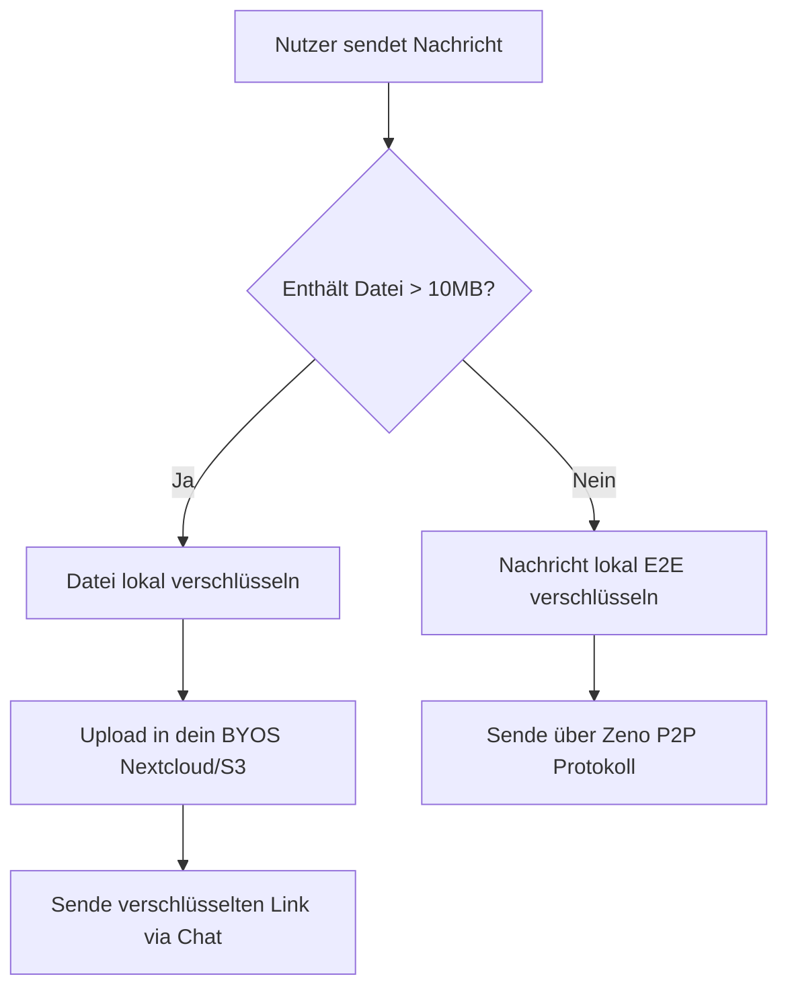

# Zeno — Secure Developer Collaboration Hub

[](LICENSE)
[](https://tauri.app/)
[](https://microsoft.github.io/monaco-editor/)

**Zeno** ist eine dezentrale Kommunikations- und Entwicklungsplattform, die speziell für Entwickler und sicherheitsbewusste Teams konzipiert wurde. Zeno kombiniert Echtzeit-Chats und Voice-Streaming mit einer direkt integrierten, clientseitigen Monaco-Code-Sandbox.

---

## 🛡️ Unser Ziel: Ein Riegel gegen die EU-Chatkontrolle

Die Privatsphäre und das Fernmeldegeheimnis stehen unter Beschuss. Mit Gesetzesentwürfen zur flächendeckenden **EU-Chatkontrolle** (Client-Side-Scanning) soll die Ende-zu-Ende-Verschlüsselung de facto ausgehebelt werden. 

Zeno wurde als direkter **Gegenentwurf und Schutzschild** entwickelt:
* **Keine zentralen Server:** Deine Daten gehören dir. Durch das BYOS-Prinzip (Bring Your Own Storage) bestimmst du selbst, wo deine verschlüsselten Daten liegen (z. B. auf deiner eigenen Nextcloud oder einer S3-kompatiblen Instanz).
* **Lokale Schlüsselhoheit:** Krypto-Schlüssel werden ausschließlich clientseitig generiert, verarbeitet und niemals auf fremde Server hochgeladen.
* **Client-Side WASM Sandbox:** Jeglicher geteilter Programmcode wird isoliert in deiner lokalen Browser/Tauri-Wasm-Umgebung ausgeführt. Kein externer Server sieht deinen Code oder die Rechenergebnisse.

---

## ⚡ Die wichtigsten Benefits auf einen Blick

* **BYOS (Bring Your Own Storage):** Vollständige Entkopplung von Chat-Dienst und Dateispeicherung. Verbinde Nextcloud oder AWS S3 im Handumdrehen.
* **Integrierter Monaco-Editor:** Der offizielle VS-Code-Editor direkt im Chat, inklusive automatischer Syntaxerkennung basierend auf Dateiendungen.
* **On-Demand Laufzeitumgebungen:** Installiere oder lösche Laufzeitumgebungen (Python WASM/Pyodide, .NET Simulator für C#, Rust Simulator, C++ WASM Simulator) direkt über die Benutzereinstellungen.
* **Social Recovery (3-Stufen-Modell):** Wiederherstellung deiner Identität über Shamir's Secret Sharing, verteilt auf 5 Vertrauenspersonen – komplett ohne zentrale Passwörter.
* **Ultra-Performant & Leichtgewichtig:** Geschrieben in Rust (Tauri v2) und React 19.

---

## 📊 Interaktive Architektur & Workflow

Hier siehst du, wie Zeno deine Privatsphäre kryptografisch absichert:



<details>
<summary>🛠️ <b>Interaktive Setup-Checkliste (Ausklappen)</b></summary>

### Vorbereitung
- Node.js (v18+) und npm auf deinem System installieren.
- Rust-Toolchain installieren (falls Tauri nativ gebaut werden soll).

### Installation & Start
1. Repository klonen und in das Verzeichnis navigieren.
2. Projektabhängigkeiten installieren:
   ```bash
   npm install
   ```
3. Den Tauri-Entwicklungsserver starten:
   ```bash
   npm run tauri dev
   ```
</details>

<details>
<summary>💡 <b>FAQ zur Monaco-Editor-Laufzeit (Ausklappen)</b></summary>

#### Warum muss ich Laufzeiten manuell installieren?
Um Ressourcen zu sparen und die App-Dateigröße minimal zu halten, wird standardmäßig nur die JavaScript/TypeScript-Sandbox nativ mitgeliefert. Andere Laufzeiten wie Python (Pyodide WASM, ~12 MB) oder der .NET-Simulator können on-demand in den Einstellungen heruntergeladen und lokal im Cache abgelegt werden.

#### Ist der ausgeführte Code sicher?
Ja, die gesamte Ausführung findet clientseitig in einer isolierten Sandbox (Web Worker oder WebAssembly-Kontext) statt. Der Code hat keinen Zugriff auf deine Tauri-Rust-API oder das lokale Dateisystem, sofern du es nicht explizit erlaubst.
</details>

---

## 📜 Lizenz & Attribution

Zeno steht unter der **Apache License 2.0**.
Diese Lizenz schreibt zwingend vor, dass bei Verwendung oder Modifikation des Quellcodes alle ursprünglichen Urheberrechtshinweise und die Liste der beitragenden Entwickler (**Zeno Contributors**) angegeben werden müssen. Details findest du in der [LICENSE](LICENSE) sowie in der [LICENSES.md](LICENSES.md) für Drittanbieter-Lizenzen.
